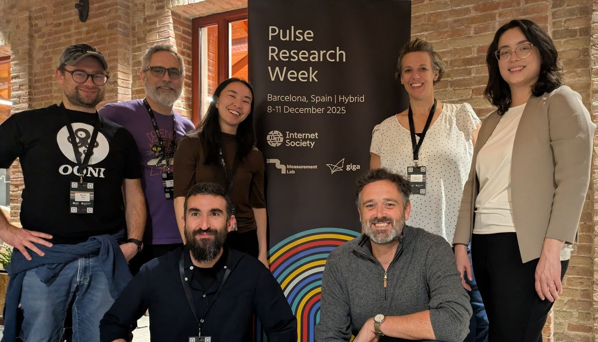
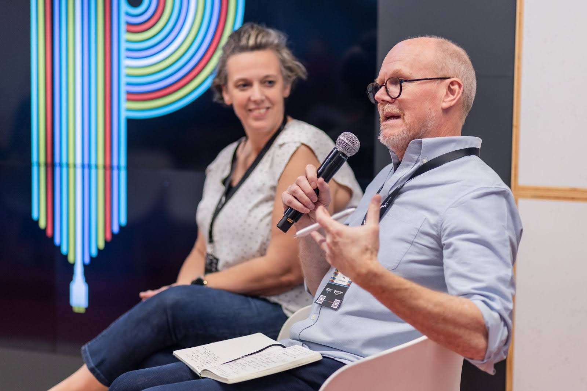
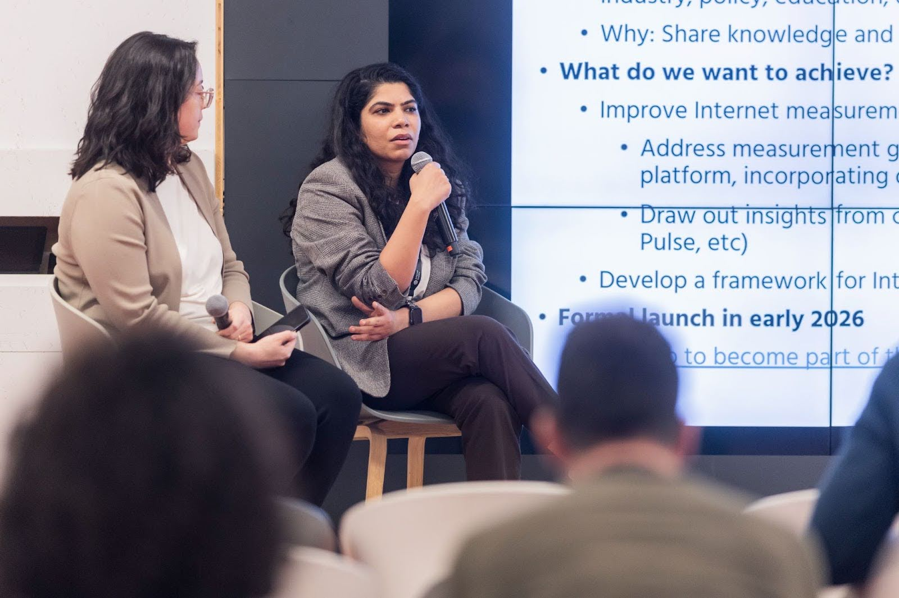
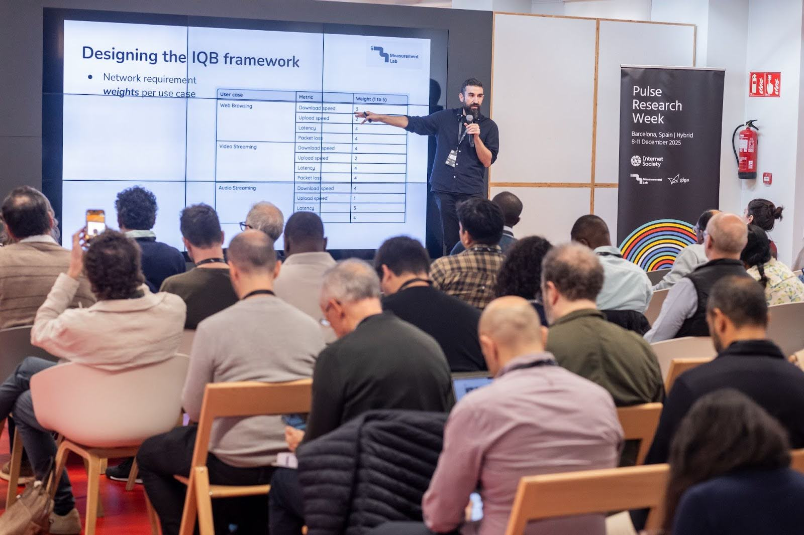

From December 8-11, 2025,  Measurement Lab (M-Lab) joined the Internet Society
[Pulse Research
Week](https://www.internetsociety.org/events/internet-society-pulse-research-week/).
On Day 4 Pavlos Sermpezis, M-Lab’s Director, Technical Lead, presented the
[Internet Quality
Barometer](/blog/iqb/)
prototype at the [Giga](https://giga.global/) offices in Barcelona. M-Lab
discussed with the audience how IQB could be adapted for education.

During the closing session, Melissa Newcomb, M-Lab’s Senior Program Manager,
led a reflection session featuring Georgia Bullen (M-Lab Advisory Committee
Chair), Steve Song (Internet Society), and Shilpa Arora (Giga). The panel
discussed how to take the knowledge gathering throughout the week and how to
apply it to solve challenges in connectivity.   
   
Throughout Pulse Research Week, the M-Lab team learned from diverse
stakeholders and experts who are passionate about improving connectivity
worldwide. The Internet Society and Giga are critical partners for M-Lab and it
was powerful to combine our shared expertise and apply it to the issue of
improving connectivity in underserved regions. We look forward to carrying the
momentum of last week into 2026\! 

